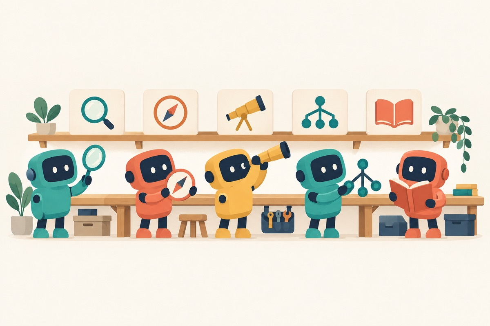
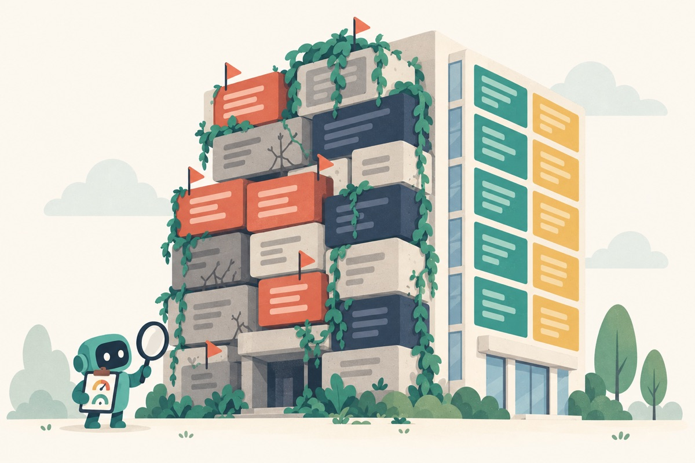
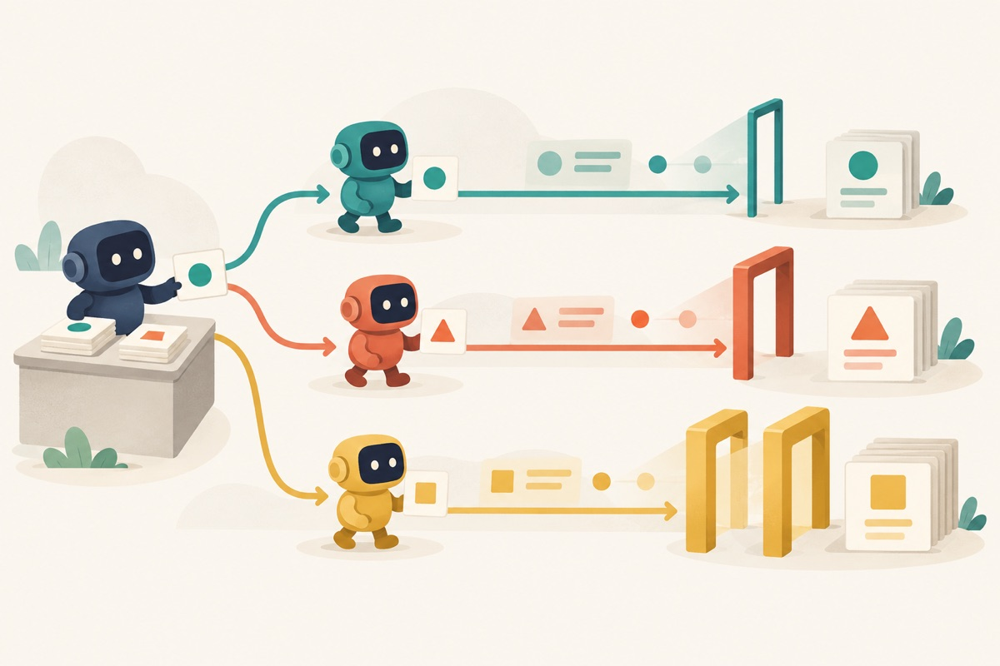
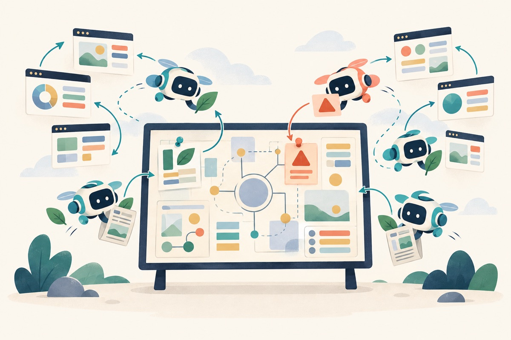
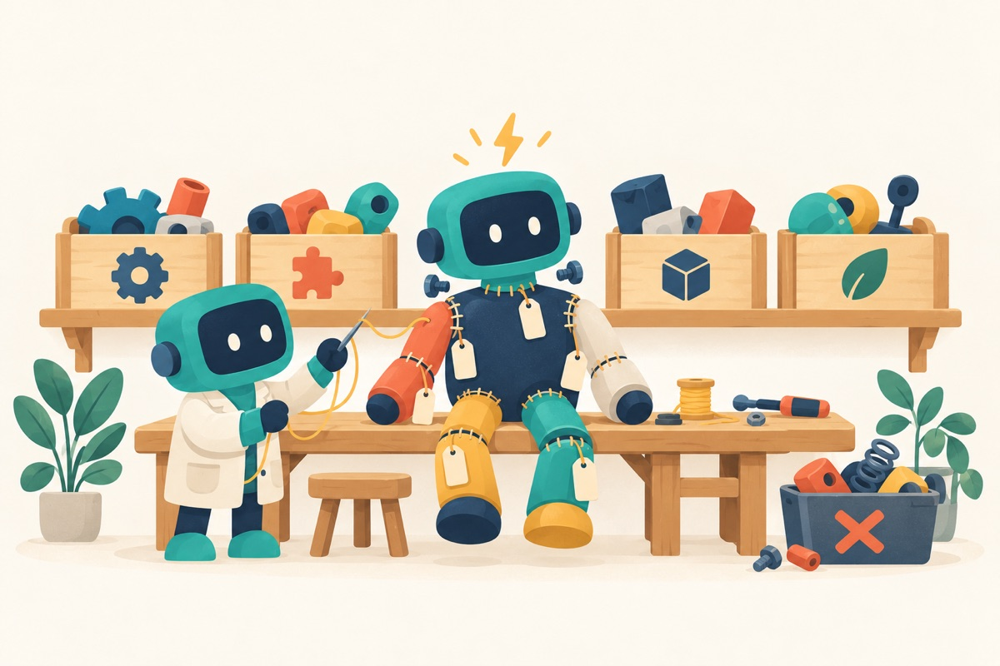
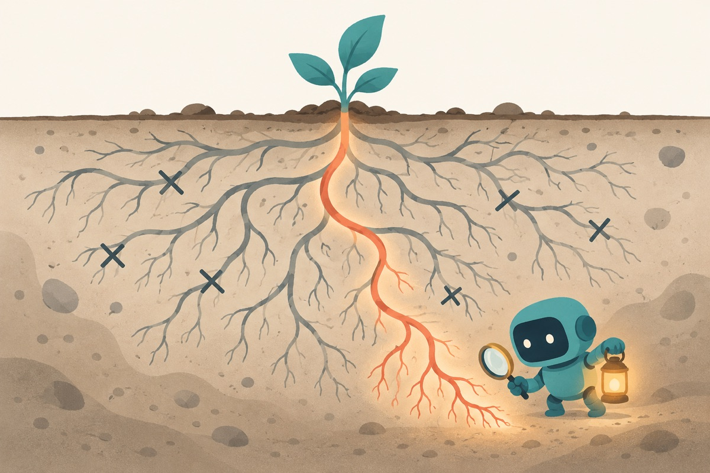
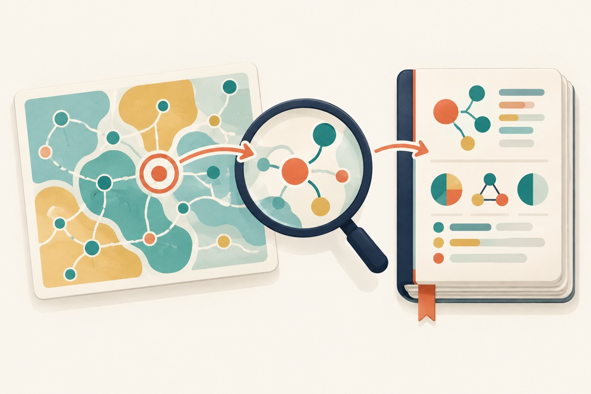

# skills

[](LICENSE)



Your coding agent is clever. It still doesn't know what shipped last week, which of its own lines
are dead weight, or how far to trust the branch another agent just pushed.

A skill is a small folder of knowledge that an agent loads only when the task needs it. These are
the ones I wrote for my own work. They carry the facts, checks and pitfalls a model is missing, and
leave the planning to the model. Think of it as handing a sharp colleague the right notebook, not a
script to read from.

Every skill follows the open [Agent Skills](https://agentskills.io) format, so it works in Claude
Code, Claude.ai, Codex, Cursor, Gemini CLI and other agents that read skills.

## A closer look

### ai-slop-detector



Code written by agents tends to grow sideways: near-duplicate helpers, files nothing imports,
packages that never existed. This skill runs deterministic analyzers first and reads second, so
the audit starts from evidence instead of a vibe.
[Read the skill →](skills/engineering/ai-slop-detector)

### external-agent-delegation



Hand work to Codex, Cursor or Gemini running in parallel, then review each result as hard as the
model behind it deserves. A strong model in its strong zone gets a light check. A model released
this morning gets the double gate. An optional refresh pass looks up the newest models and their
benchmarks, even ones that shipped a few hours ago.
[Read the skill →](skills/engineering/external-agent-delegation)

### freshness-check



A plan is only as current as the model that wrote it. Before you build, cheap scout models search
the web to test the plan's assumptions, and the main model decides what actually changes.
[Read the skill →](skills/engineering/freshness-check)

### frankenstein-code



Half of what you want to build probably exists on GitHub already. This skill splits the goal into
parts, finds open-source code for each one, checks its license and activity, takes only the pieces
you need, and tags every piece with where it came from.
[Read the skill →](skills/engineering/frankenstein-code)

### causal-root-cause-analyst



A headline is the plant you can see. The cause is somewhere in the roots. This skill collects the
competing explanations, tests each one against evidence, and tells you which root it really was,
in plain language.
[Read the skill →](skills/research/causal-root-cause-analyst)

### study-notes-pdf



Big picture first, then the zoom. You get a researched study guide with diagrams and examples,
delivered as a PDF you can actually sit down and read.
[Read the skill →](skills/learning/study-notes-pdf)

## All skills

### Engineering

| Skill | What it does | Needs |
|---|---|---|
| [ai-slop-detector](skills/engineering/ai-slop-detector) | Audits a codebase for AI-generated quality decay (duplication, dead code, over-engineering, hallucinated packages) using deterministic analyzers first and reading second. | Python 3.9+; optional lint tools |
| [bootstrap-system-md](skills/engineering/bootstrap-system-md) | Explores a repo and writes a `SYSTEM.md`: one tool-agnostic reference every coding agent reads before working, plus shims and a hygiene gate. | Any agent |
| [external-agent-delegation](skills/engineering/external-agent-delegation) | Hands repo work to parallel coding agents (Codex, Cursor, Gemini) and calibrates review depth to the model that did the work. | Other agent CLIs |
| [frankenstein-code](skills/engineering/frankenstein-code) | Finds open-source code that already solves part of a goal, vets it, takes only the needed pieces and records provenance. | Web + GitHub search |
| [freshness-check](skills/engineering/freshness-check) | Sends cheap scout models to the web to test a plan's assumptions against what is current before you build on it. | Claude Code subagents |
| [goal-anchored-delegation](skills/engineering/goal-anchored-delegation) | Carries the user's *goal*, not just the plan, into every handoff and grades how much freedom the executing agent gets. | Any agent |
| [ui-ux-audit](skills/engineering/ui-ux-audit) | Audits a frontend against UI/UX basics (states, accessibility, tokens, spacing, type, color, hierarchy) and reports fixes with file:line. | Any agent |

### Research

| Skill | What it does | Needs |
|---|---|---|
| [causal-root-cause-analyst](skills/research/causal-root-cause-analyst) | Digs into what is really behind a claim, headline, metric move or incident, tests competing causes against evidence, and tells the verdict as a plain story. Includes DiD, RDD, IV, PSM, Benford and GRIM scripts. | Web search; Python for data mode |
| [saving-raw-sources](skills/research/saving-raw-sources) | Collects research sources as RAW files, one per source, with the original wording kept intact. | Web fetch |
| [synthesize-research-insights](skills/research/synthesize-research-insights) | Reads a RAW source folder and writes plain-language insights with pointers back to each source. | Local files |

### Learning

| Skill | What it does | Needs |
|---|---|---|
| [study-notes-pdf](skills/learning/study-notes-pdf) | Builds a researched, big-picture-first study guide with diagrams and examples, delivered as a polished PDF. | Python + Playwright |

## Install

<details open>
<summary><b>Any agent (skills CLI)</b></summary>

```bash
npx skills add AjeyDS/skills
```

Pick one skill with `--skill <name>`, a target agent with `-a <agent>`, or see the list with `--list`.
</details>

<details>
<summary><b>Claude Code (plugin marketplace)</b></summary>

```
/plugin marketplace add AjeyDS/skills
/plugin install engineering@ajeyds-skills
/plugin install research@ajeyds-skills
/plugin install learning@ajeyds-skills
```
</details>

<details>
<summary><b>Claude.ai</b></summary>

Download a skill's `.zip` from the [latest release](https://github.com/AjeyDS/skills/releases/latest),
then go to **Customize → Skills → + → Upload a skill**. Code execution must be on.
</details>

<details>
<summary><b>Manual</b></summary>

Copy a skill folder into your agent's skills directory, for example `~/.claude/skills/<name>/`
(Claude Code), `~/.agents/skills/<name>/` (Codex and others), `~/.cursor/skills/` or `~/.gemini/skills/`.
</details>

## Notes

- Skills that run scripts list their requirements in the `compatibility` field of their `SKILL.md`.
- `external-agent-delegation` ships the author's dated model notes as an example. Copy
  `references/your-setup.md` to `your-setup.local.md` (gitignored) and fill in your own agents;
  let your own record replace the notes over time.
- Illustrations were generated with Codex's built-in image generation.
- Issues and suggestions are welcome.

## License

[MIT](LICENSE)
