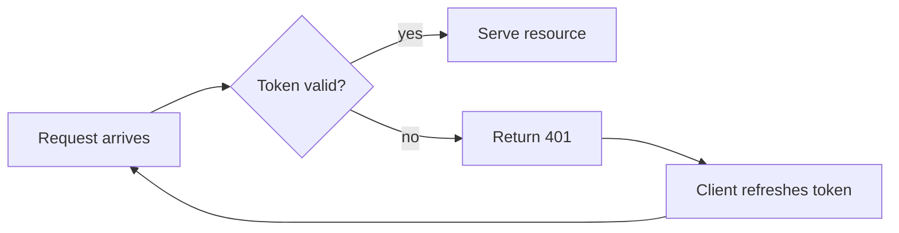
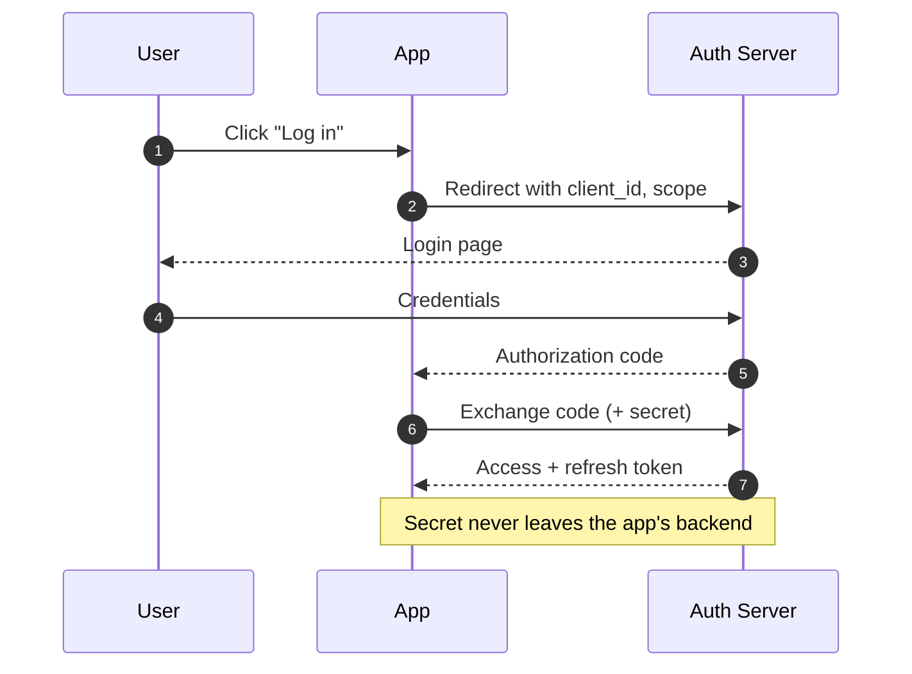
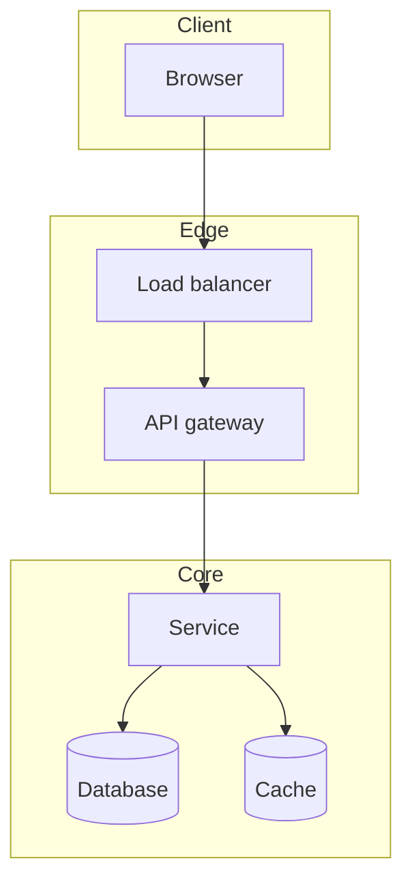
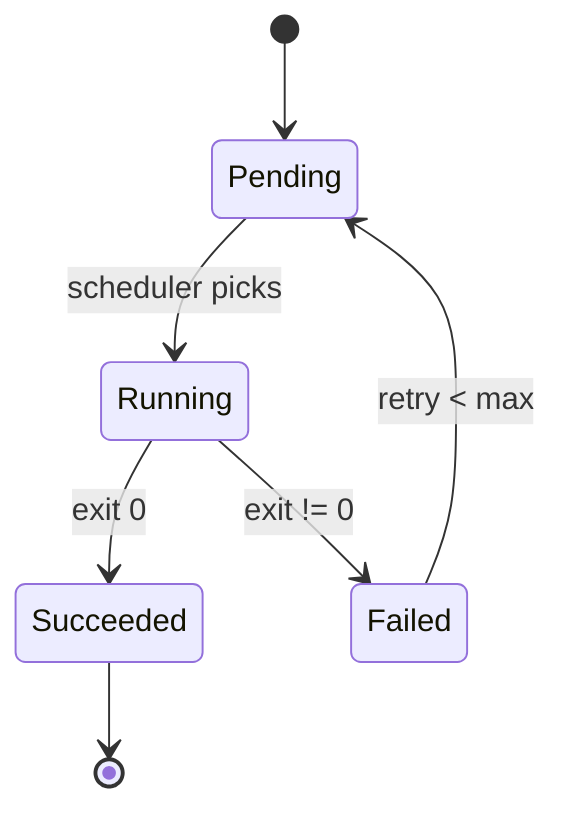

# Visuals reference

## Which picture for which idea

| The idea has… | Draw a… | Mermaid type |
|---|---|---|
| steps in order, decisions | flowchart | `flowchart LR` |
| actors exchanging messages over time | sequence diagram | `sequenceDiagram` |
| a thing that moves between states | state diagram | `stateDiagram-v2` |
| parts that contain / relate to parts | component or class diagram | `flowchart TB` with subgraphs, or `classDiagram` |
| events on a timeline | timeline | `timeline` |
| two or more options compared on criteria | table (not a diagram) | Markdown table |
| a quantity that changes (curve, distribution) | plot | matplotlib → PNG |
| a memory / byte / grid layout | hand SVG or matplotlib | — |

If a source diagram exists and fetches cleanly, use it for the "parts" or "flow" rung and draw your
own only for what it doesn't cover.

## Mermaid that renders well on an A4/Letter page

The PDF page is about 700 px wide at print scale. Diagrams wider than that get scaled down and become
unreadable. Rules of thumb:

- **Sizing is the thing that goes wrong most.** The builder scales every diagram to fit the page
  width and caps its height at about two-thirds of a page. So a left-to-right flow with more than ~5
  nodes shrinks until labels are 6 pt, and a top-to-bottom flow with more than ~8 nodes hits the height
  cap and shrinks too. Keep flows to ≤ 5 nodes LR or ≤ 8 nodes TB; split anything bigger into an
  "overview" diagram plus a "zoomed" one. Sequence diagrams: ≤ 4 participants, ≤ 10 messages.
- **Flows go left-to-right** (`flowchart LR`) for short linear flows, top-to-bottom (`TB`) when there
  are branches or more than five steps, because the page is taller than it is wide.
- **Short labels.** Two to four words per node; put the explanation in the text, not the box.
  Use ` ` for a second line only when needed.
- **Sequence diagrams:** Use `Note over A,B: …` for the one
  crucial explanation. Number the messages with `autonumber` so the text can refer to "step 4".
- **Use subgraphs to show grouping** (e.g. "client side" vs "server side") — this alone often makes a
  diagram teach.
- **One caption line in italics below each diagram** saying what to look at: *Figure 3 — the token
  refresh path; note that the resource server never sees the refresh token.*

### Patterns

Flow with a decision:

Sequence with grouping note:

Parts with subgraphs:

State machine:

## Fetching source images

`scripts/fetch_image.py <url> <out-path>` downloads and validates: content-type is an image, size is
between 8 KB and 8 MB, dimensions are at least 400 px wide, and it isn't a near-square tiny image (a
logo or avatar). It exits non-zero with a reason if any check fails — treat that as "draw it instead".

Where to look for candidates during research: the topic's official docs (architecture pages are
usually diagram-rich), Wikipedia/Wikimedia (SVG diagrams, freely licensed), well-known engineering
blogs (Medium, company blogs, Baeldung, DigitalOcean tutorials), and papers (figure 1 is usually the
architecture). Prefer diagrams that show the *same* parts your text names; a beautiful diagram with
different vocabulary costs the reader a translation step.

Put the source credit in the caption: *Figure 2 — request lifecycle (source: Envoy docs).*

## Drawing with matplotlib

For curves, distributions, or grids, keep it minimal: one figure, `figsize=(7, 3.5)`, `dpi=150`,
label axes in plain words, annotate the one point that matters, no gridlines unless reading values
matters, `plt.tight_layout()`, save as PNG next to `notes.md`. Colours: two or three at most.

## Hand SVG

Use for memory layouts, packet formats, matrix pictures. Keep the viewBox around 700×N, font-size
14–16, `font-family: system-ui, sans-serif`. Reference it as an image (``); the builder
inlines SVGs so they print crisp.
